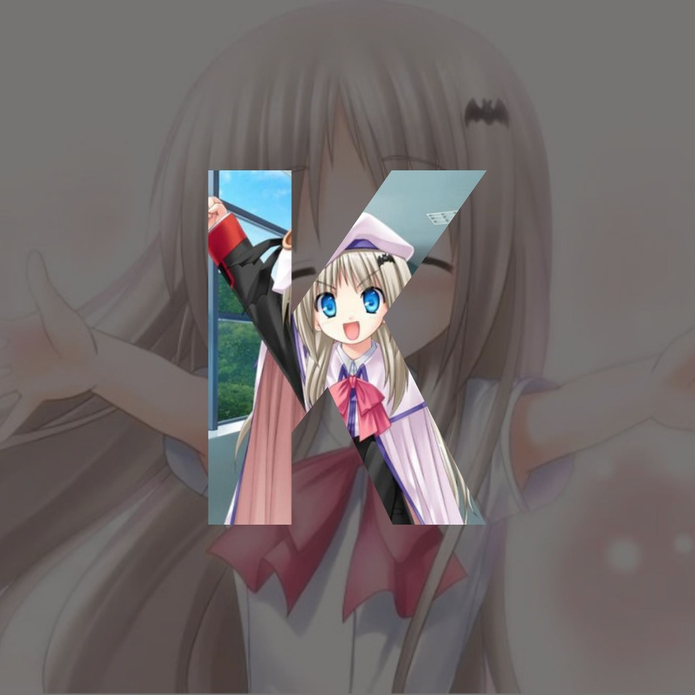

<div align="center">



# 📺 KudTube

### *Lightweight, ad-free desktop YouTube client with MPV playback & offline downloads.*

[](https://github.com/NekoIsUnavailable/KudTube)
[](https://mpv.io)
[](https://github.com/yt-dlp/yt-dlp)
[](LICENSE)

</div>

---

## Features

- **Ad-Free YouTube Streaming**: Zero ads, zero tracking, zero Google account required.
- **YouTube Desktop Watch Layout**: Native theater mode, interactive timeline scrubber, volume controls, speed settings, and fullscreen.
- **Quality Selector**: Switch between `1080p Full HD`, `720p HD`, `480p`, and `Auto` resolution on the fly.
- **True Offline Downloads**: Download any video or audio directly to disk in `1080p`, `720p`, or `MP3 Audio` with live progress bars. Watch without an internet connection.
- **Playlists & Watch Later**: Create local custom playlists, import YouTube playlists, and save videos to Watch Later with one click.
- **Light & Dark Themes**: Pixel-accurate YouTube light and dark mode styling with instant toggle.
- **Hardware-Accelerated MPV Core**: Uses bundled `mpv` with GPU acceleration for 60fps playback and minimal CPU/memory usage.

---

## Development & Build

```bash
# Start development mode
npm run dev

# Build frontend
npm run build

# Package desktop installer and portable zip
npm run package
```
